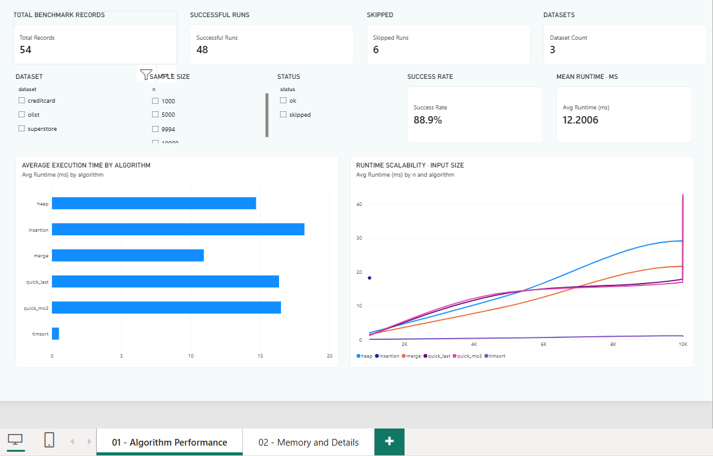
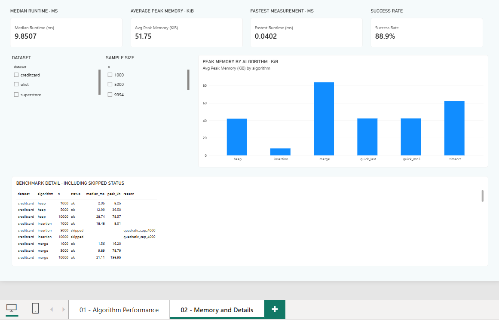

# SortingLab — Power BI Desktop Dashboard

This folder contains the working native **SortingLab Power BI Dashboard** and its editable Power BI Project source.

## Files
- **[SortingLab_Dashboard_Final.pbix](SortingLab_Dashboard_Final.pbix)** — final Power BI Desktop report. Download and open with Microsoft Power BI Desktop.
- **[SortingLab_PowerBI_Source_Project.zip](SortingLab_PowerBI_Source_Project.zip)** — source project (PBIP + Report + SemanticModel + benchmark data and setup guides). Extract the ZIP, then open `SortingLab_Dashboard/SortingLab_Dashboard.pbip`.
- [Previous interactive HTML preview](SortingLab_Interactive_Dashboard.html) — a separate HTML demonstration, **not** the Power BI Desktop file.

## Dashboard pages
**01 — Algorithm Performance:** KPI cards for Total Records, Successful Runs, Skipped Runs, Dataset Count, Success Rate and Average Runtime; slicers for dataset, sample size and status; average execution time by algorithm; runtime scalability by input size.

**02 — Memory and Details:** KPI cards for median runtime, average peak memory, fastest measurement and success rate; peak memory by algorithm; dataset/size slicers; detailed benchmark table including skipped-run reasons.

## Screenshots from the working Power BI Desktop report

**Page 01 — Algorithm Performance**

**Page 02 — Memory and Details**

These are real report-page screenshots supplied by the project author, not the separate HTML preview.

## Captured benchmark results
| Metric | Value |
| --- | ---: |
| Total records | 54 |
| Successful measurements | 48 |
| Skipped | 6 |
| Datasets | 3 |
| Success rate | 88.9% |
| Mean runtime | 12.2006 ms |
| Median runtime | 9.8507 ms |
| Mean peak memory | 51.75 KiB |
| Fastest measurement | 0.0402 ms |

The source experiment compares **insertion, merge, quick_last, quick_mo3, heap and Python Timsort** on numeric values from **Superstore, Olist and Credit Card Fraud** data. There are three input-size groups (approximately 1,000, 5,000, and 10,000 values; Superstore's largest valid sample contains 9,994). Six insertion-sort combinations above 4,000 elements were skipped with `reason=quadratic_cap_4000` and have no measured runtime (do not treat as zero).

**Interpretation:** For fair performance or memory comparisons, filter to the *same dataset and sample size*. Aggregates across all sample sizes have unequal algorithm coverage because insertion sort was skipped for large inputs. Results document the captured run, not a universal ranking.

## Opening and submission
1. Download `SortingLab_Dashboard_Final.pbix`.
2. Open it in **Power BI Desktop**; no ZIP extraction is needed for the PBIX version.
3. Use its two page tabs and slicers to explore the benchmark.
4. The editable project is in `SortingLab_PowerBI_Source_Project.zip`. The `.pbip` manifest alone is **not** the complete project.

## Updating the measurements

The current semantic model embeds the captured measurements with Power Query `#table`. Refreshing it does not read a newly generated CSV. To use a new benchmark run, change the `SortingBenchmark` query to read that CSV, preserving the table and column names, then apply changes and save. See the [data-source update instructions](PowerBI_Dashboard_Instructions.md#cập-nhật-dashboard-có-sẵn-bằng-kết-quả-mới). After the query points to a CSV file, Refresh reads the file at the configured path.

GitHub hosts the files for download and version history; it does not render native interactive PBIX content. No sensitive Kaggle raw datasets are included in the Power BI source package, only benchmark measurements. Created from the Power BI Desktop report validated by the user on **2026-11-11**.
